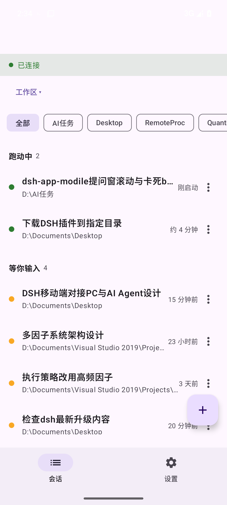
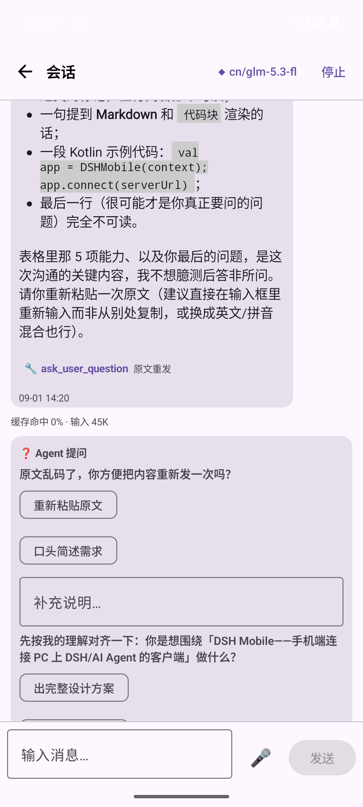
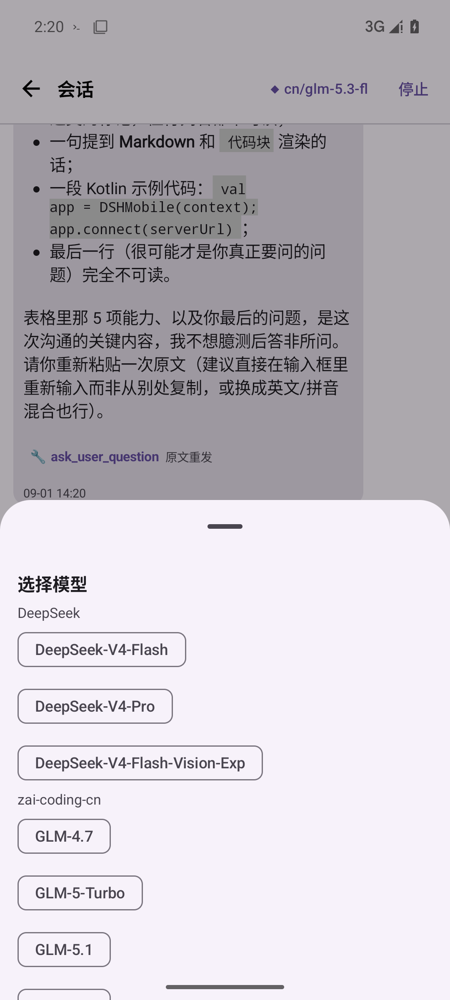
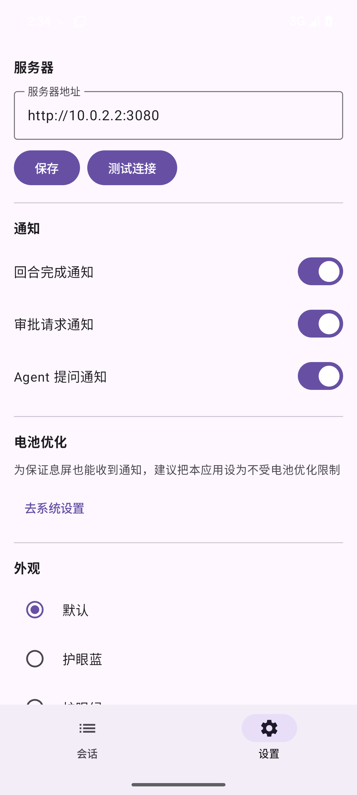

# DSH Mobile


DSH Mobile 是 [DeepSeek Harness](https://github.com/deepseek-ai/deepseek-harness) 的安卓客户端。它使用 Kotlin、Jetpack Compose 和 Material3，提供会话列表、对话、审批与提问、排队消息、系统通知和底部实时思考预览。

手机通过 Tailscale 私有网络访问电脑上的 DSH。App 连接的是你自己的宿主，不在手机内运行模型。

### App 界面一览（旧版）

以下四张为旧版界面实拍，不代表 v0.1.223 的冰蓝光幕或极光舱。

| 会话列表 | 对话页 | 模型选择 | 设置 |
|:---:|:---:|:---:|:---:|
|  |  |  |  |

## 安装与连接

1. 电脑先安装并配置 DSH，确认本地会话能正常使用。安装方法见[上游项目](https://github.com/deepseek-ai/deepseek-harness)。
2. 手机与电脑加入同一 tailnet，并确保访问规则允许手机访问电脑。登录方式不限于邮箱，见 [Tailscale 身份提供商说明](https://tailscale.com/docs/integrations/identity)。
3. 按 [Tailscale 远程访问指南](Tailscale远程访问DSH-安装使用文档.md) 配置 HTTPS 入口与认证。已有部署先检查实际配置，避免覆盖正在使用的服务。
4. 从 [DSH Mobile v0.1.223](release/DSH-Mobile-release-v0.1.223.apk) 下载发布 APK，在 Android 8.0 及以上设备安装。正式 APK 统一放在仓库的 [release/](release/) 目录，可查阅 [SHA-256 校验值](release/SHA256SUMS)。
5. App 设置页填写服务器地址并保存，按系统提示开启通知权限；需要后台通知时，再按设备要求放宽电池限制。
6. 打开真实会话，验证历史可读取、消息能发送、交互能回答。设置页“测试连接”只检查首页可达，不能替代这些验证。

项目的端口约定：**3080 用于已有生产 DSH，3081 用于隔离测试，避免影响生产**。网关监听端口必须由部署配置单独指定。源码中的网关默认端口为 3081，不代表生产推荐值，也不能据此切换已有 Tailscale Serve。

### 服务器地址与认证

- 裸地址示例：`https://<机器名>.<tailnet>.ts.net/`。仅在宿主已配置并验证免令牌访问，或 App 已有有效凭证时使用。
- 带令牌链接示例：`https://<机器名>.<tailnet>.ts.net/?token=<令牌>`。App 会尝试换取并保存会话 Cookie，后续请求继续使用该凭证。有效期由宿主决定；令牌已使用或凭证失效时，需从宿主获取新的有效链接。
- 首页可以打开，不代表 API 或 WebSocket 已认证。旧网关认证钩子在新宿主上可能只放行首页；详见[网关兼容说明](docs/dsh-auth-gateway-plugin.md)。

## 当前功能与边界

| 功能 | 当前行为 |
| --- | --- |
| 会话列表 | 按跑动中、等你输入、空闲分组，组内按标题排序；支持工作区过滤、重命名、分叉与归档 |
| 空白会话 | 隐藏空白和子代理会话；本机已成功发送消息的会话豁免空白隐藏 |
| 对话 | 本地发送立即回显；运行中约每 2 秒对账已落定历史，不能保证回复正文逐字出现 |
| 发送顺序 | 宿主返回相同请求编号时，不依赖正文或时钟确认本地消息并清除副本，用户消息按历史顺序位于对应回复前；旧宿主缺编号时仍受保守文字与时间匹配限制 |
| 实时思考 | 支持宿主的会话流时，底部单行快速更新最新末行，可展开全文；上滑查看历史时保留位置 |
| 审批与提问 | 显示已有和新增交互；支持选项、补充回答、限时等待及宿主允许的稍后回答；普通消息不会代替交互答案 |
| 排队与插话 | 支持编辑、删除队列项及在运行中插话；最终状态以宿主回显为准 |
| 通知 | 回合完成、审批和提问；依赖 Android 通知权限、后台运行条件及网络 |
| Markdown | 支持表格、图片、链接、代码和列表；图片地址须在设备上可达；Mermaid 显示源码 |
| 选择与复制 | 思考等 Compose 文本可选中；Markdown 正文未开启文本选择，不能统一长按复制所有气泡 |
| 模型选择 | 支持供应商、模型和思考等级，目录依赖宿主接口兼容；详见 [USAGE.md](USAGE.md#模型选择) |
| 外观 | 设置 → 外观：冰蓝光幕（默认）或极光舱；切换后会记住选择 |
| 语音 | 使用设备语音识别服务，识别结果填入输入框，不自动发送 |

详细操作见 [USAGE.md](USAGE.md)。

## 已验证记录

**v0.1.223（版本号 224）**：230 项单测全部通过，Debug/Release 构建及正式签名校验通过。Android 35 模拟器验证了双皮肤切换、重启保留、会话列表及历史、模型面板打开和返回关闭，以及由正式签名 v0.1.222 覆盖升级并启动。业务场景使用隔离数据，未连接生产宿主，也未进行真机验证。

以下是历史版本验收记录，验证范围以各次记录为准。根目录的 `ws_after.png`、`ws_ok.png` 以及 `docs/screenshots/` 内的演示和思考流截图均为历史证据，不代表 v0.1.223 外观。页首图标预览来自 v0.1.223 APK 的 192 px 启动图标，Android 启动器可能按系统样式裁切或着色。此处尚无 v0.1.223 的新版界面截图。

- [消息顺序与结束状态的连续GIF、测试结果和验证边界](test-evidence/message-order-20261021/README.md)
- [铠甲鲸鱼图标的设备验收](test-evidence/launcher-icon-20261021/README.md)
- [实时思考的 GIF、测试结果与验证边界](test-evidence/thinking-preview-20261021/README.md)
- [已有提问可见、App 回答及队列继续的 GIF 证据](test-evidence/pending-interactions-20261020/README.md)

实时思考详细动画记录对应先前的v0.1.190（175项测试），交互记录对应其各自版本；这些历史记录不替代当前包或各个部署环境的验收。

## 本地构建

在 Windows PowerShell 中，从项目的 ASCII 路径执行。路径含中文时，可使用指向本仓库的 ASCII 盘符或目录别名；下列命令从当前目录取路径，不依赖固定盘符。

```powershell
powershell -ExecutionPolicy Bypass -File .\tools\setup_build_env.ps1
$projectRoot = (Get-Location).Path
$env:JAVA_HOME = Join-Path $projectRoot '.toolchain\jdk17'
$env:ANDROID_HOME = Join-Path $projectRoot '.toolchain\android-sdk'
$gradle = Join-Path $projectRoot '.toolchain\gradle-8.9\bin\gradle.bat'
& $gradle -p $projectRoot --no-daemon testDebugUnitTest
& $gradle -p $projectRoot --no-daemon assembleDebug
```

安装脚本将 JDK 17、Android SDK 和 Gradle 8.9 放在项目的 `.toolchain/`。当前构建配置使用 AGP 8.6.1、Kotlin 2.0.20、minSdk 26、targetSdk 35。

### 发布签名与版本

发布签名读取未入库的 `keystore/keystore.properties`，字段为 `storeFile`、`storePassword`、`keyAlias`、`keyPassword`。`storeFile` 相对项目根目录解析。仅在密钥配置正确时构建正式发布包：

```powershell
& $gradle -p $projectRoot --no-daemon assembleRelease
```

缺少密钥配置时，Release 不会自动使用 Debug 签名，不能把生成文件当作已签名发布包。发布前须验证签名。同一签名通常可覆盖安装；签名不一致不能覆盖，卸载会清除本地设置和凭证。

每次包含 `assemble` 的 Gradle 调用都会递增 `app/version.properties` 中的补丁版本和 `versionCode`，测试任务不会递增。已签名变体的命名产物位于 `app/build/outputs/apk/<变体>/DSH-Mobile-<变体>-v<版本>.apk`。

私有默认地址可放入未入库的 `app/personal.properties`，字段为 `DEFAULT_BASE_URL` 与 `TRUSTED_AUTHORITY`。公共构建默认地址为空，首次使用需填写。

## 文档入口

- [功能使用指南](USAGE.md)
- [Tailscale 安装、端口与分层排障](Tailscale远程访问DSH-安装使用文档.md)
- [当前架构与源码入口](docs/ARCHITECTURE.md)
- [旧版铠甲鲸鱼图标设计（历史记录）](docs/requirements/2026-10-21-铠甲鲸鱼图标.md)
- [网关协议、配置与兼容边界](docs/dsh-auth-gateway-plugin.md)
- [网关源码包说明](tools/dsh-auth-gateway/README.md)
- [历史设计记录](docs/DESIGN.md)
- [开发进度](PROGRESS.md)

## 许可证

[MIT](LICENSE)
