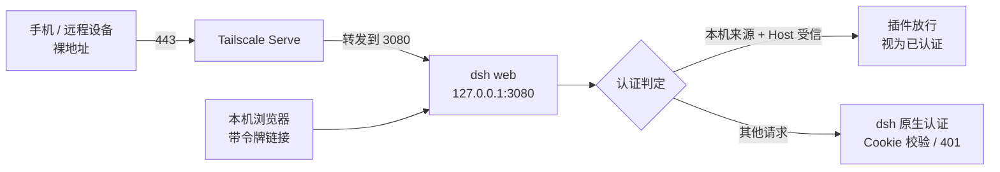

# dsh-auth-gateway

DSH 免令牌网关插件：让手机 App 用**裸地址**（不带 `?token=`）访问 dsh Web UI。

> **当前状态（2026-10-18 复查）**：插件在 dsh 进程内生效，是手机远程访问的关键组件。
> 实测证据见第 6 节。**卸载后手机裸地址会变 401**，因此不要删。
> 当前版本 `1.1.1`，dsh 版本 `0.1.5-rc.2`。

## 目录

1. [为什么会有这个插件](#1-为什么会有这个插件)
2. [当时提的要求](#2-当时提的要求)
3. [方案怎么一步步定下来](#3-方案怎么一步步定下来)
4. [现在它是怎么工作的](#4-现在它是怎么工作的)
5. [版本历史](#5-版本历史)
6. [当前实际状态（2026-10-18 实测）](#6-当前实际状态2026-10-18-实测)
7. [依赖契约与升级自检](#7-依赖契约与升级自检)
8. [文件与位置](#8-文件与位置)
9. [安装、恢复、卸载](#9-安装恢复卸载)
10. [运维排查](#10-运维排查)
11. [踩过的坑](#11-踩过的坑)
12. [安全边界](#12-安全边界)
13. [变更记录](#13-变更记录)

---

## 1. 为什么会有这个插件

dsh 从 `0.1.2-rc.1` 起给 Web UI 加了一次性令牌认证。

每次 `dsh web` 启动，进程内随机生成一枚令牌。
裸地址访问会返回 401，提示重新打开 dsh 打印的链接。

带 `?token=...` 打开一次，会换到一份会话 Cookie（默认 30 天）。
之后带 Cookie 的请求可以直接通过。

问题在于令牌**每次重启都换**。
手机 App 若只填地址，重启一次 dsh 就再也连不上。

手机 App 的目标用法是：**只填 `https://<机器名>.<tailnet>.ts.net/`，一直能用**。
所以必须有人替 App 完成"令牌换 Cookie"，并且长期自动进行。

## 2. 当时提的要求

用户逐字要求（2026-09-16）：

1. "能否实现 远端app无感 本地路由自动填入 token？？"
2. "所谓无感是 app只使用无token的 url"；"若带了token也能识别支持"
3. "他应该是一个无感 伴随dsh启动跟随启动的东西"
4. "而不是独立维护的"
5. "dsh有很多 管理bat 这个东西 和控制bat毫无关联 完全无法配套管理"
6. "任何修改都要动bat 那简直没完没了"
7. "不要动已有bat"

归纳成四条硬约束：

| 约束 | 含义 |
|---|---|
| 无感 | App 只填裸地址，令牌由系统自己处理 |
| 跟随 dsh | 随 dsh 启动、随 dsh 退出，不额外常驻 |
| 不独立维护 | 不新增计划任务、不新增需要照看的进程 |
| 不碰 bat | 桌面启动脚本一个字都不改 |

## 3. 方案怎么一步步定下来

一共走过五个方案，前四个都因为违反上述约束被否掉。

| 方案 | 做法 | 结果 |
|---|---|---|
| A. App 内换 Cookie | App 解析 `?token=`，换 Cookie 并持久化 30 天 | 保留为兜底；不满足"只用无 token 地址" |
| B. 改启动 bat | 在 `启动DSH-WebUI.bat` 里顺带起代理 | **否决**：违反第 5、6、7 条 |
| C. 独立代理 + 计划任务 | 外部 Node 进程读日志取令牌，计划任务开机自启 | **否决**：违反第 3、4 条；误关窗口即断连；可能被安全软件拦 |
| D1. 插件 + 网关端口 | 插件在 3081 起反向代理；`tailscale serve` 指向 3081 | **实现并验证通过，但落地受阻** |
| **D2. 插件 + 认证放行**（采纳） | 插件在 dsh 认证判定上放行"经 Serve 转发"的请求 | **采纳**：Serve 保持 3080，不动任何脚本 |

D1 受阻的原因：桌面启动脚本自带一段逻辑。
脚本发现 Serve 没指向 3080 时，会自动把它指回 3080。

所以"让 Serve 指向 3081"这条路，每次重启 dsh 都会被覆盖。
而用户明确要求不改脚本。

D2 因此改为：Serve 不动，插件在 dsh 自己的认证入口上放行。

D1 的反向代理能力保留在插件里，配置项 `port` 默认 3081。
它现在是备用形态，Serve 不再指向它。

## 4. 现在它是怎么工作的

dsh 的请求认证有**两个入口**，插件两处都包了一层：

| 入口 | 管什么 | 插件怎么做 |
|---|---|---|
| `connection.requestRejection` | API 请求（RPC 通道，含 `/api` 前缀与各通道路由） | 原生判定不通过时，若请求来自 Serve 则放行 |
| `connection.authorizeIndex` | 首页 HTML | 请求来自 Serve 时直接返回"可以渲染" |

放行判据是**两个条件同时满足**：

| 条件 | 取值 | 为什么 |
|---|---|---|
| 来源地址 | 本机 loopback（`127.0.0.1` / `::1`） | Tailscale Serve 是本机进程，转发必来自 loopback |
| `Host` 头 | 命中 dsh 的 `--trusted-host` 名单 | 本机浏览器用 `127.0.0.1:3080` 访问时 Host 不受信，仍走原生认证 |

两个条件一起卡住范围：不是本机转发的不放行，Host 对不上的也不放行。



本机浏览器照旧用 dsh 打印的带令牌地址，行为完全不变。

## 5. 版本历史

三个版本都在 2026-09-16 同一天产出，原因是当天连续排障。

| 版本 | 时间 | 改动 | 当时暴露的问题 |
|---|---|---|---|
| `1.0.0` | 09-16 19:39 | 反向代理形态：3081 转发到 3080，自动注入会话 Cookie | Serve 被启动脚本强制指回 3080，形态无法落地 |
| `1.1.0` | 09-16 19:47 | 新增 `requestRejection` 放行 | API 通了，**首页仍 401** |
| `1.1.1` | 09-16 19:48 | 补 `authorizeIndex` 放行 | 首页也通了，方案定稿 |

`1.1.0` 的教训：首页走的是另一条认证入口。
只补 `requestRejection` 时，接口能用、页面打不开。

## 6. 当前实际状态（2026-10-18 实测）

当天复查了"这个插件还有没有用"，结论是**仍在使用**。

实测对照（本机无 Cookie、直接请求）：

| 请求 | 结果 | 说明 |
|---|---|---|
| `Host: carl-pc.taild10021.ts.net` → 3080 | **200** | 插件放行生效（与手机同一 Host 路径） |
| `Host: 127.0.0.1:3080` → 3080 | **401** | 原生认证保留，范围没有扩大 |
| `127.0.0.1:3081` 直接访问 | **200** | 备用反向代理在跑，但 Serve 不经过它 |

dsh 日志（`%USERPROFILE%\.dsh\logs\dsh-webui.log`）：

```
[auth-gateway] 已开启 tailnet 免令牌放行（受信 Host: carl-pc.taild10021.ts.net, ...）
[auth-gateway] 免令牌网关已就绪: http://127.0.0.1:3081 → http://127.0.0.1:3080
[auth-gateway] 已刷新会话 Cookie
```

其他事实：

- `tailscale serve status` 显示 `443 → http://127.0.0.1:3080`，没有指向 3081。
- 桌面启动脚本传参 `--trusted-host carl-pc.taild10021.ts.net`。
- 受信名单里还挂着旧域名 `carl-pc.tail98fa18.ts.net`，属历史遗留，不影响判断。
- 两个端口（3080、3081）都属于同一个 dsh 进程，不是独立进程。

**删除的影响**：放行逻辑随插件消失，dsh 恢复原生认证。
手机裸地址会 401，只剩"带令牌链接换 Cookie"一条路（Cookie 30 天后过期）。

想自己复验，跑这两条对照（第二条应输出 401）：

```powershell
# 模拟手机经 Serve 转发：Host 是 tailnet 域名、不带 Cookie，应输出 200
try { (Invoke-WebRequest "http://127.0.0.1:3080/" -Headers @{Host='carl-pc.taild10021.ts.net'} -UseBasicParsing).StatusCode }
catch { $_.Exception.Response.StatusCode.value__ }

# 对照：本机裸 Host、不带 Cookie，应输出 401
try { (Invoke-WebRequest "http://127.0.0.1:3080/" -UseBasicParsing).StatusCode }
catch { $_.Exception.Response.StatusCode.value__ }
```

## 7. 依赖契约与升级自检

这一节写给升级 dsh 的人看。它回答三件事：插件靠什么活着、升级会坏在哪、坏了两分钟能查出原因。

### 7.1 依赖清单

插件不打包任何第三方依赖，运行在 dsh 进程内，靠宿主提供模块与服务。

| 依赖 | 形态 | 用途 | 升级风险 |
|---|---|---|---|
| `connection` 服务 | Cordis 注入 `inject: ["connection"]` | 取认证入口 | 服务名或注入名变更则插件不加载 |
| `connection.trustedHosts` | 数组 | 判断 Host 是否受信 | 语义变更则放行范围错 |
| `connection.requestRejection(request)` | 返回 `undefined` / `401` / `403` | API 放行 | **0.2.x 起 `/api` 改走 `admit`，只包它不再覆盖 API** |
| `connection.authorizeIndex(req, res)` | 返回布尔 | 首页放行 | 签名变化（0.2.x 多一个 `secure` 参数，两参调用仍可） |
| `connection.authenticatedUrl(baseUrl)` | 返回带 `?token=` 的地址 | 换会话 Cookie | 交付物变更则备用形态失效 |
| `@deepseek-ai/schemastery` | 宿主提供（dsh 依赖它） | 配置校验 | 包名或导出变更则插件加载失败 |
| `node` | 宿主运行时 | 内置 `node:http` | 版本过低则语法或 API 不可用 |

`schemastery` 的解析路径：dsh 把它装在自己的依赖树里，profile 的 `node_modules` 中也有提升副本。
插件 `import` 时从已安装目录向上查找，因此不需要写进自己的 `dependencies`。

### 7.2 Cordis 插件合同（dsh 加载器要求）

dsh 用 Cordis 加载插件。插件包必须满足下面五条，缺一条就不加载或加载即报错。

1. ESM 包：`package.json` 有 `"type": "module"`，并有 `main` 或 `exports` 指向入口。
2. 导出 `name`：稳定插件名，Cordis 用它标识插件。
3. 导出 `inject`：字符串数组，声明依赖的服务名，如 `["connection"]`。
4. 导出 `Config`：schemastery 配置模式，字段写 `.default()` 给默认值。
5. 导出 `apply(ctx, config)`：入口函数；用 `ctx.effect(fn, label)` 注册需要清理的资源，返回函数在卸载时调用。

### 7.3 bundle 注册协议

插件要被 dsh 加载，还需要两步登记：

1. `package.json` 的 `dsh.bundle.patch` 指向自己的 `cordis.patch.yml`。
2. patch 文件用 `- insert:` 注册条目，条目至少写 `id` 与 `name`：

```yaml
- insert:
    - id: auth-gateway
      name: 'dsh-auth-gateway'
```

3. 安装后，`~/.dsh/profiles/web/package.json` 的 `dsh.profile.bundles` 必须有插件名。
   没有登记就不加载；清单变更不支持热加载，必须重启 dsh。

用户自己的 `cordis.patch.yml` 覆盖配置时，patch 是**整对象替换**语义。
覆盖 `id: auth-gateway` 时，`config` 字段要写全，漏字段会被默认值补回。

### 7.4 dsh 认证协议

这些行为是插件依赖的前提，写在 dsh 的 `dsh-client-connection` 与 `dsh-web-app` 里：

| 项 | 行为 |
|---|---|
| 启动令牌 | 每次 `dsh web` 启动随机生成，放在 `?token=`，一次性 |
| 换 Cookie | GET `/?token=...` 返回 303 + `Set-Cookie`，Cookie 绑定 Host 权威 |
| 会话有效期 | `cookieMaxAgeDays`，默认 30 天 |
| 401 | 没有有效令牌或 Cookie |
| 403 | Host 不在 `--trusted-host` 名单（Host/Origin 围栏先于认证） |
| 认证入口 | 0.1.5：`/api` 与首页分别走 `requestRejection`、`authorizeIndex` |

### 7.5 最小版本要求

| 项 | 要求 | 依据 |
|---|---|---|
| dsh | 0.1.2-rc.1 起有令牌认证；本插件 4 个接口在 0.1.5-rc.2 实测存在 | 设计文档与 2026-09-16 实测 |
| Node | 跟随 dsh 自身要求；本机 v25.2.1 实测可用 | 插件未声明 `engines` |
| Cordis | 跟随 dsh（0.1.5-rc.2 用 4.0.2） | 宿主依赖 |
| schemastery | 跟随 dsh（0.1.5-rc.2 用 3.18.2） | 宿主依赖 |

更早的 dsh 版本是否具备这 4 个接口，未逐一验证。升级前先按 7.7 自检，不要靠猜。

### 7.6 已知差异：dsh 0.2.x

2026-10-18 对 `@deepseek-ai/dsh-client-connection@0.2.1-rc.2` 做了静态比对（下载包、读源码）。
结论来自源码，**未在 0.2.x 实例上实测**：

| 项 | 0.1.5-rc.2 | 0.2.1-rc.2 |
|---|---|---|
| `/api` 路由认证入口 | 调 `connection.requestRejection` | 直接调 `connection.admit`，返回 `{ peer }` 或 `{ rejection }` |
| `requestRejection` | 认证入口 | 只剩一层包装，内部调 `admit` |
| 首页入口 `authorizeIndex` | 两参 | 三参（多 `secure`），两参调用仍可用 |
| `authenticatedUrl` | 存在 | 存在 |
| `trustedHosts` | 存在 | 存在 |
| 新增概念 | 无 | `Peer`、`admit`、`authenticateApi`、`/connect` 路由 |

对插件的影响：升级到 0.2.x 后，**首页放行仍会生效，API 放行会失效**，表现是页面能开、App 连不上。
改法是把包装点从 `requestRejection` 换成 `admit`，放行时返回一个 Peer 记录。
具体怎么构造 Peer，需要按目标版本的实现再核对。

### 7.7 升级前后自检

升级 dsh 前后各跑一遍，两分钟能定位问题。命令可整段复制。

```powershell
$log = "$env:USERPROFILE\.dsh\logs\dsh-webui.log"

# 1) 版本
dsh --version

# 2) 插件是否加载（应有 [auth-gateway] 行）
Select-String $log -Pattern "auth-gateway" -SimpleMatch | Select-Object -Last 3

# 3) 端口在听（3080 必须有；3081 是备用，没有也不影响放行）
Get-NetTCPConnection -LocalPort 3080,3081 -State Listen -ErrorAction SilentlyContinue |
    Select-Object LocalPort,OwningProcess

# 4) 放行是否生效：域名 Host 应 200
try { (Invoke-WebRequest "http://127.0.0.1:3080/" -Headers @{Host='carl-pc.taild10021.ts.net'} -UseBasicParsing).StatusCode }
catch { $_.Exception.Response.StatusCode.value__ }

# 5) 对照：本机裸 Host 应 401（不是 401 说明认证范围被放宽了）
try { (Invoke-WebRequest "http://127.0.0.1:3080/" -UseBasicParsing).StatusCode }
catch { $_.Exception.Response.StatusCode.value__ }
```

判定标准：

| 观察 | 含义 |
|---|---|
| 第 2 项有输出、第 4 项 200、第 5 项 401 | 放行正常 |
| 第 2 项无输出 | 插件没加载，先查 bundles 清单与安装目录 |
| 第 4 项 401、第 5 项 401 | 放行没生效，检查 Host 与判据 |
| 第 4 项 200、第 5 项 200 | 判据被绕过，范围过宽，要收 |
| 第 3 项没有 3080 | dsh 没起来，看 `dsh-webui.err.log` |

失败后按顺序查：

1. 看 `%USERPROFILE%\.dsh\logs\dsh-webui.err.log` 的报错原文。
2. 确认新版本里 `dsh-client-connection` 的认证入口是否变化（见 7.6）。
3. 确认 `profiles\web\node_modules\dsh-auth-gateway` 目录还在。
4. 确认 `dsh.profile.bundles` 里有 `dsh-auth-gateway`。
5. 改插件后，按隔离实例验证（随机端口 + 独立 home），不要直接重启 3080。

## 8. 文件与位置

| 用途 | 路径 |
|---|---|
| 源码工程 | `F:\AI任务\dsh-mobile-app\tools\dsh-auth-gateway\` |
| 已安装副本 | `C:\Users\Carl\.dsh\profiles\web\node_modules\dsh-auth-gateway\` |
| 安装包（引用的那份） | `C:\Users\Carl\.dsh\local-plugins\dsh-auth-gateway-1.1.1.tgz` |
| 安装包（历史版本） | 同目录下 `1.0.0`、`1.1.0` 两个 tgz |
| 一键安装 / 修复脚本 | `F:\AI任务\dsh-mobile-app\tools\install-auth-gateway.ps1` |
| 设计文档与验证记录 | `F:\AI任务\dsh-mobile-app\docs\dsh-auth-gateway-plugin.md` |

源码工程结构：

```
tools/dsh-auth-gateway/
├── package.json          # dsh.bundle.patch 声明
├── cordis.patch.yml      # 注册条目：id=auth-gateway
├── lib/index.mjs         # 插件实现，零第三方依赖
├── README.md             # 本文
└── dsh-auth-gateway-*.tgz  # 打包产物（1.1.1 是当前版本）
```

安装包里会带上 `README.md`，所以本文随包分发。

## 9. 安装、恢复、卸载

### 9.1 日常不用管

插件装在用户目录，dsh 每次启动按 `dsh.profile.bundles` 清单加载。
不需要任何外部机制，日常也没有需要跑的命令。

### 9.2 需要重装的情况

新机器部署、误删过 `~/.dsh`、dsh 大版本升级后插件没了。

一条命令完成（幂等，重复跑只报告状态）：

```powershell
powershell -ExecutionPolicy Bypass -File "F:\AI任务\dsh-mobile-app\tools\install-auth-gateway.ps1"
```

脚本会：选版本号最大的 tgz → 对比当前状态 → 需要时执行 `dsh plugin --profile web add` →
复查并移除冲突项 `dsh-file-upload` → 提示重启 dsh。

### 9.3 手动安装

```powershell
$env:DSH_HOME = "C:\Users\Carl\.dsh"
dsh plugin --profile web add "C:\Users\Carl\.dsh\local-plugins\dsh-auth-gateway-1.1.1.tgz"
# 重启 dsh 生效（bundles 清单变更不支持热加载）
```

安装后**必须**复查 `~/.dsh/profiles/web/package.json` 的 `dsh.profile.bundles`：
不能出现 `dsh-file-upload`，否则 dsh 启动即崩（见第 11 节）。

### 9.4 卸载（确认不再需要远程访问才做）

```powershell
$env:DSH_HOME = "C:\Users\Carl\.dsh"
dsh plugin --profile web remove dsh-auth-gateway
# 重启 dsh 生效；之后手机需改用"带令牌链接"方式访问
```

`tailscale serve` 保持指向 3080 即可，不用改。
卸载后若想恢复，按 9.2 或 9.3 重新安装。

## 10. 运维排查

| 现象 | 先查什么 | 怎么修 |
|---|---|---|
| 手机裸地址 401 | 日志有没有 `[auth-gateway] 已开启 tailnet 免令牌放行` | 没有则重启 dsh 让插件加载 |
| 手机完全连不上 | `tailscale serve status` 是否指向 3080 | 指向不对就重设：`tailscale serve --bg --https=443 http://127.0.0.1:3080` |
| 手机连不上、本机正常 | 手机 Tailscale 是否在线 | 手机端恢复连接 |
| 首页打不开、API 能用 | 插件版本是否为 1.1.1 | 升级到 1.1.1（1.1.0 缺首页放行） |
| 日志 `监听 3081 失败: listen EADDRINUSE` | 3081 被占用 | 备用端口，不影响放行；可改配置或释放端口 |
| 本机浏览器 401 | 这是正常现象 | 用 dsh 打印的带令牌链接打开 |
| 不想免令牌 | —— | 用户 `cordis.patch.yml` 把 `allowTailnetForwarded` 设为 `false`，重启 dsh |

配置覆盖要写成整对象（patch 是整对象替换语义，字段必须写全）：

```yaml
- id: auth-gateway
  config:
    allowTailnetForwarded: true
    port: 3081
    upstreamHost: 127.0.0.1
    upstreamPort: 3080
    cookieRefreshMs: 21600000
```

## 11. 踩过的坑

**一、`dsh-file-upload` 同名冲突**。
dsh 0.1.5 起内置了 `file-upload`。
第三方同名插件同时挂载会报 `duplicate loader entry id`，dsh 启动即崩。

麻烦在于：`dsh plugin add` 有时会把它重新登记进 bundles。
所以每次安装完都要复查清单，安装脚本已内置自动清理。

**二、`dsh plugin install` 不补齐插件**。
手动删掉 `node_modules` 里的插件目录后跑 `install`，输出"已是最新"。
插件没回来，bundles 登记也一起被清掉。

原因是清单记录的是"实际安装状态"，不是"期望状态"。
恢复的唯一办法是重新 `add` 插件包。

**三、首页和 API 是两条认证入口**。
只包 `requestRejection` 时接口通了、首页仍 401。
这是 1.1.0 升到 1.1.1 的原因。

**四、Serve 被启动脚本强制指回 3080**。
脚本里有一段"发现 Serve 不对就重设"的逻辑。
所以 D1 形态（Serve 指 3081）每次重启都被覆盖，才改为 D2。

**五、本机 `127.0.0.1:3080` 不带令牌是 401**。
这不是故障。放行只针对"经 Serve 转发的受信 Host"。
本机浏览器要用 dsh 打印的带令牌链接。

**六、旧域名残留**。
受信名单里同时有 `taild10021`（新）和 `tail98fa18`（旧账号）。
日志里可能出现重复项，匹配用"域名相等"判断，重复无害。

## 12. 安全边界

放行的含义是：**Tailscale 私有网络内可达的设备，访问 Web UI 不再需要令牌**。

具体边界：

- 信任落在 tailnet 内。公网仍然不可达。
- 只放行"本机来源 + Host 受信"的请求，其他路径不改。
- 想恢复原生认证：关掉 `allowTailnetForwarded`，或卸载插件。

## 13. 变更记录

| 日期 | 变更 |
|---|---|
| 2026-09-16 15:27 | App 侧适配：粘贴带令牌链接换 Cookie，401 自愈 |
| 2026-09-16 18:01 | 外部代理落地（Serve 指向 3081），附计划任务开机自启 |
| 2026-09-16 19:39 | v1.0.0：改为 dsh 插件反向代理形态，隔离环境验证通过 |
| 2026-09-16 19:39–19:47 | 发现启动脚本会覆盖 Serve 指向，D1 无法落地，转认证链放行 |
| 2026-09-16 19:47 | v1.1.0：新增 `requestRejection` 放行（API 通、首页仍 401） |
| 2026-09-16 19:48 | v1.1.1：补 `authorizeIndex`，首页放行；主 profile 升级安装 |
| 2026-09-16 22:29 | dsh 重启上线：真实域名 API 与首页实测 200；旧外部代理机制清理 |
| 2026-10-18 | 复查确认仍在生效（本文重写为完整来龙去脉版） |

## 相关文档

- 设计细节与验证记录：`docs/dsh-auth-gateway-plugin.md`
- 项目总说明：`F:\AI任务\dsh-mobile-app\README.md`
